# Entity Relationship Diagram (ERD) & Struktur Database

## 1. Skema Relasi Inti

```mermaid
erDiagram
    COMPANIES ||--o{ BRANCHES : owns
    BRANCHES ||--o{ BRANCH_USERS : assigns
    USERS ||--o{ BRANCH_USERS : has
    ROLES ||--o{ PERMISSIONS : contains
    USERS ||--o{ ROLES : holds

    COMPANIES ||--o{ CATEGORIES : categorizes
    COMPANIES ||--o{ UNITS : defines
    UNITS ||--o{ UNIT_CONVERSIONS : converts

    COMPANIES ||--o{ INGREDIENTS : owns
    COMPANIES ||--o{ PRODUCTS : owns
    PRODUCTS ||--o{ RECIPES : formulates
    RECIPES ||--o{ RECIPE_ITEMS : details
    INGREDIENTS ||--o{ RECIPE_ITEMS : supplies

    BRANCHES ||--o{ PURCHASES : issues
    SUPPLIERS ||--o{ PURCHASES : billed_by
    PURCHASES ||--o{ PURCHASE_ITEMS : contains
    PURCHASES ||--o{ PURCHASE_RECEIPTS : receives
    PURCHASE_RECEIPTS ||--o{ PURCHASE_RECEIPT_ITEMS : receives_items
    PURCHASES ||--o{ PURCHASE_PAYMENTS : pays

    BRANCHES ||--o{ PRODUCTION_ORDERS : executes
    RECIPES ||--o{ PRODUCTION_ORDERS : uses
    PRODUCTION_ORDERS ||--o{ PRODUCTION_MATERIALS : consumes
    PRODUCTION_ORDERS ||--o{ PRODUCTION_OUTPUTS : produces
    PRODUCTION_ORDERS ||--o{ PRODUCTION_COSTS : incurs

    BRANCHES ||--o{ STOCK_MOVEMENTS : logs
    BRANCHES ||--o{ STOCK_TRANSFERS : from_branch
    BRANCHES ||--o{ STOCK_TRANSFERS : to_branch
    STOCK_TRANSFERS ||--o{ STOCK_TRANSFER_ITEMS : transfers

    BRANCHES ||--o{ SALES : rings_up
    CUSTOMERS ||--o{ SALES : patronizes
    SALES ||--o{ SALE_ITEMS : items
    SALES ||--o{ SALE_PAYMENTS : tendered
    SALES ||--o{ SALE_RETURNS : refunds

    COMPANIES ||--o{ CHART_OF_ACCOUNTS : maintains
    COMPANIES ||--o{ JOURNAL_ENTRIES : records
    JOURNAL_ENTRIES ||--o{ JOURNAL_LINES : debits_credits
    CHART_OF_ACCOUNTS ||--o{ JOURNAL_LINES : allocates

    COMPANIES ||--o{ EXPENSES : incurs
    EXPENSE_CATEGORIES ||--o{ EXPENSES : classifies
    BRANCHES ||--o{ CASH_TRANSACTIONS : vaults
```

## 2. Definisi Tipe Data Standar
- Kolom moneter (harga, subtotal, total, saldo, biaya): `DECIMAL(18, 2)`
- Kolom kuantitas persediaan & konversi: `DECIMAL(18, 4)` untuk mengakomodasi satuan pecahan presisi (contoh: 0.0025 kg atau ragi).
- Foreign Key: `UNSIGNED BIGINT` dengan `ON DELETE RESTRICT` pada transaksi finansial dan stok demi menjaga jejak audit.
- Kolom status: `VARCHAR(32)` atau ENUM konsisten.
- Kolom timestamp: `TIMESTAMP` terindeks.
